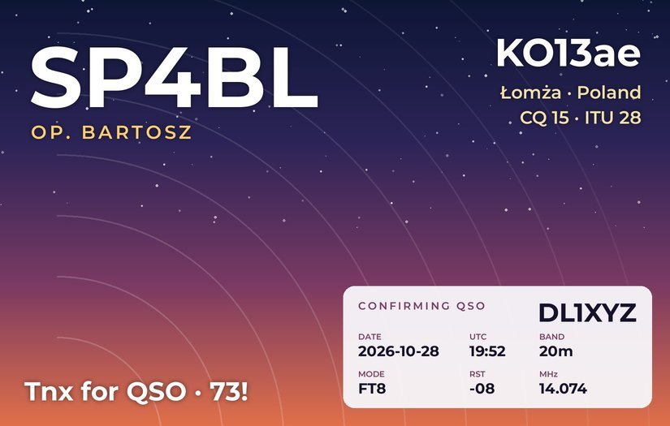
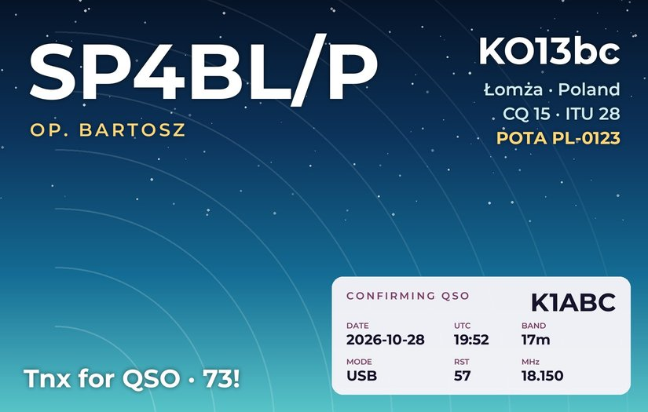
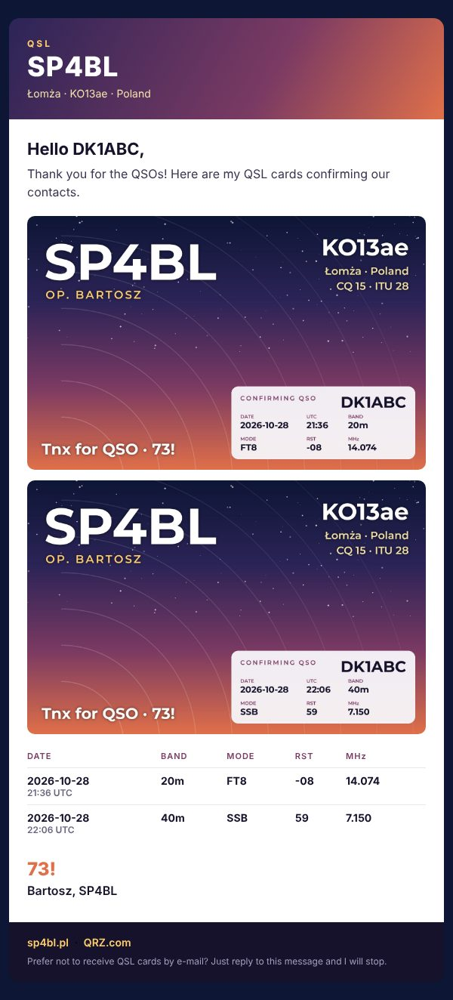
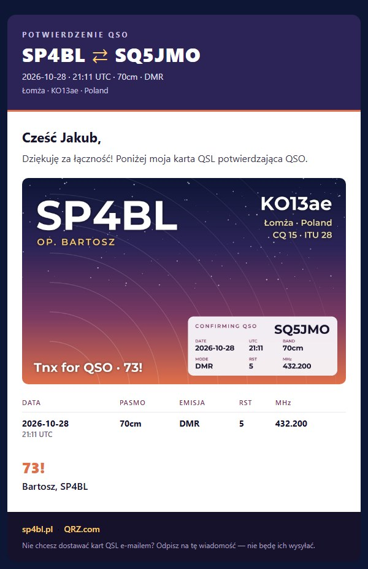
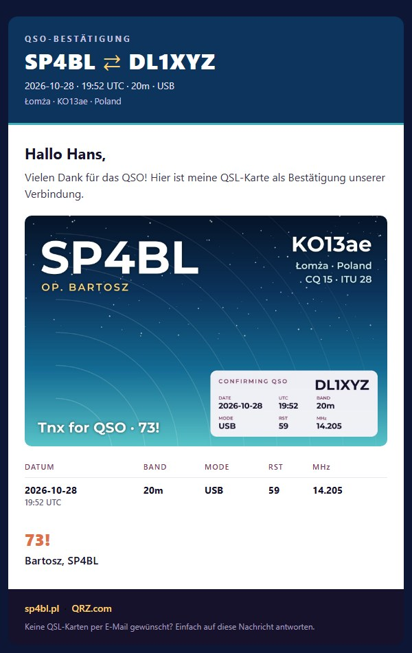
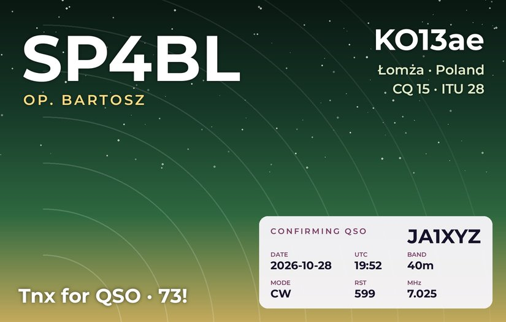

# Wavelog QSL Mailer

[](https://buymeacoffee.com/sp4bl)

Send QSL cards by e-mail from your self-hosted [Wavelog](https://github.com/wavelog/wavelog).

For every new QSO in your log it:

1. **finds the e-mail address** of the station you worked on QRZ.com or HamQTH (with the credentials
   already in your Wavelog) and stores it in the QSO, like Wavelog's *Update from Callbook* does;
2. **sends a QSL card**: a nicely formatted HTML mail with a personalised card image showing
   the callsign, date, UTC, band, mode, RST and frequency;
3. **marks the QSO** in Wavelog as *QSL sent: Yes, via Electronic*.

It runs next to Wavelog (a sidecar container or a small service) and never touches Wavelog's files,
so Wavelog updates do not affect it.

| Generated card | With a park activation (/P, POTA) | Mail |
|---|---|---|
|  |  |  |

## Features

- **Zero-config card.** Your callsign, operator name, grid, QTH, country and CQ/ITU zones come
  from your Station Location in Wavelog. Three colour themes. Or use your own photo, or your own
  finished card design.
- **Uses Wavelog's own settings:** database, QRZ.com/HamQTH login, SMTP server and sender address.
- **Several Station Locations** (home, /P, a second call): each QSO gets the card of the station
  it was made from, including the grid and POTA/WWFF/SOTA reference of that QSO.
- **One mail per contact.** QSOs with the same station on several bands go into one mail, one card each.
- **Languages:** English, Polish and German, picked from the contacted station's prefix.
- **Safe by default:**
  - cards only for QSOs after a start date you choose;
  - a waiting time after each QSO (to fix typos, and to put several bands into one mail);
  - a limit of mails per run and an opt-out list;
  - every QSO gets its card only once.
- **Dry run** shows who would get which card, with previews of the cards and the mail, without sending anything.

## Screenshots

### Mails

| Two QSOs, one mail (English) | One QSO (Polish) | Theme `ocean` (German) |
|---|---|---|
|  |  |  |

The header and the card follow the `theme` set in `[card]`. The mail is plain HTML with tables and
inline styles, so it looks the same in Gmail, Outlook, Apple Mail and Thunderbird. The cards are
embedded as JPG files, and a plain-text version goes along for clients without HTML
(`html = false` sends only the plain text with the cards attached).

### Card themes

| `dusk` | `ocean` | `forest` |
|---|---|---|
|  |  |  |

## Requirements

- Wavelog (Docker or a regular Linux / Raspberry Pi install)
- E-mail set up in Wavelog: *Admin → Global Options → Email*, protocol **SMTP**
  (the *Send Test Mail* button there must work)
- A callbook login in Wavelog's `config.php`. QRZ.com gives e-mail addresses only with an
  **XML Logbook Data subscription**; HamQTH is free. Addresses already in your QSOs are used anyway.

## Installation

### Docker (Wavelog in Docker, also Portainer / Dockhand)

1. Create a folder for the mailer next to your Wavelog `docker-compose.yml` and a config file in it:

   ```bash
   mkdir qsl-mailer
   curl -o qsl-mailer/config.ini https://raw.githubusercontent.com/gerlowski/wavelog-qsl-mailer/main/config.example.ini
   ```

   In `config.ini` set `since` (the first QSO date to send cards for, e.g. today) and
   `station_ids` (leave it empty for now; the first run lists your Station Locations with their IDs).

2. Add the service to your Wavelog stack ([examples/docker-compose.yml](examples/docker-compose.yml)):

   ```yaml
     wavelog-qsl-mailer:
       image: ghcr.io/gerlowski/wavelog-qsl-mailer:latest
       container_name: wavelog-qsl-mailer
       command: ["--loop", "900", "--dry-run"]
       depends_on:
         - wavelog-db
       volumes:
         - ./qsl-mailer:/config
         - wavelog-config:/wavelog-config:ro
       restart: unless-stopped
   ```

   `wavelog-config` is the volume your Wavelog container mounts at
   `/var/www/html/application/config/docker` (the name used by the official compose file).
   The image runs on amd64, arm64 and armv7 (Raspberry Pi).

3. Start it and read the log: `docker logs -f wavelog-qsl-mailer`. With `--dry-run` nothing is sent:
   the log shows who would get a card, and `qsl-mailer/preview/` has the cards and the mails as HTML.
4. When it looks right, remove `"--dry-run"` from `command` and redeploy.
   From then on it runs every 15 minutes.

### Linux / Raspberry Pi (Wavelog installed with Apache or nginx)

```bash
git clone https://github.com/gerlowski/wavelog-qsl-mailer.git
cd wavelog-qsl-mailer
sudo ./install-linux.sh            # or: sudo ./install-linux.sh /path/to/wavelog
```

The installer:
- finds Wavelog (`/var/www/html`, `/var/www/wavelog`, …);
- installs the two dependencies from your distribution (`python3-pymysql`, `python3-pil`);
- copies the program to `/opt/wavelog-qsl-mailer` and lists your Station Locations to choose from;
- makes a dry run, then sets up a systemd service (`wavelog-qsl-mailer`) running every 15 minutes
  as the web server user.

Logs: `journalctl -u wavelog-qsl-mailer -f`. Running `install-linux.sh` again updates the program
and keeps your config and the record of sent cards.

### Manually (any system with Python 3.8+)

```bash
pip install git+https://github.com/gerlowski/wavelog-qsl-mailer.git
cp config.example.ini config.ini     # set config_dir, station_ids, since
qsl-mailer -c config.ini --dry-run
qsl-mailer -c config.ini             # e.g. from cron every 15 minutes
```

## The card

Pick one, in the `[card]` section of `config.ini`:

| What you do | What you get |
|---|---|
| nothing | a generated card (themes `dusk`, `ocean`, `forest`) |
| put `background.jpg` next to `config.ini` | your photo (antenna, shack, home town) behind the same layout; cropped and darkened automatically |
| set `image` and `box` | your own finished card design; the QSO data goes into the area `box = x0,y0,x1,y1` (pixels). Set `printed_callsign`/`printed_grid` to what the design shows, so QSOs from /P or another grid get a "FROM …" line |

`qsl-mailer card` writes a sample card for each Station Location to `preview/`.
In Docker: `docker exec wavelog-qsl-mailer qsl-mailer card`.

## Commands

| Command | |
|---|---|
| `qsl-mailer` | fill missing e-mails, then send new cards (once) |
| `qsl-mailer --loop 900` | the same every 15 minutes (container / service mode) |
| `qsl-mailer --dry-run` | show what would happen, write previews, change nothing |
| `qsl-mailer resend SP9ABC` | send all cards for one callsign again (testing, or on request) |
| `qsl-mailer card [CALL]` | sample cards to `preview/` |
| `qsl-mailer fill` / `send` | only one of the two steps |

In Docker, prefix with `docker exec wavelog-qsl-mailer`.

## Seeing what was sent

- **Wavelog:** *Logbook → Advanced Logbook*, filter *QSL sent = Yes* and *QSL send method = Electronic*.
  The QSO details show the date it was sent and the address it went to.
- **Your mailbox:** the *Sent* folder (when sending through Gmail, Outlook, …).
- **The log** of the container or service.

## How it works

The mailer reads Wavelog's `config.php` and `database.php` to log in to the database and the
callbooks, and the `options` table for the SMTP settings. It writes only two things in Wavelog's
database:
- the contact's e-mail (`COL_EMAIL`), and only when it is empty;
- the *QSL sent* fields after a card was mailed (`mark_qsl_sent = false` turns this off).

Which QSOs already got a card is kept in its own `state.sqlite`, so even with `mark_qsl_sent = false`
nobody gets the same card twice.

Why not Wavelog's REST API? At the moment the API does not expose the e-mail field of a QSO, so
the mailer talks to the database, read-only except for the two fields above.

## FAQ

**Will it mail my whole log?** No. Only QSOs on or after `since`. Set it to today to start with new QSOs only.

**Someone asked not to receive cards.** Add the callsign to `skip_calls` (or the address to
`skip_emails`) in `config.ini`. No restart needed.

**Gmail as SMTP server.** Use an [app password](https://myaccount.google.com/apppasswords) in
Wavelog's e-mail settings. To send as an address on your own domain, add it in Gmail under
*Settings → Accounts → Send mail as*.

**Can I change the texts?** Subjects with `subject_en`, `subject_pl`, `subject_de`. The sign-off name with
`operator`, the line under your callsign with `location`, the card's slogan with `tagline`.
Translations are welcome as pull requests (`qsl_mailer/mail.py`).

**Is sending QSLs by e-mail OK?** It is a personal reply to a contact you made, sent from your own
mailbox, with an opt-out line in every mail. Keep `max_per_run` modest, and you are
fine with any normal mail provider.

## Questions and feedback

- **Questions, setup help:** [Discussions → Q&A](https://github.com/Gerlowski/wavelog-qsl-mailer/discussions/categories/q-a)
- **Ideas and feature requests:** [Discussions → Ideas](https://github.com/Gerlowski/wavelog-qsl-mailer/discussions/categories/ideas)
- **Show your card:** [Discussions → Show and tell](https://github.com/Gerlowski/wavelog-qsl-mailer/discussions/categories/show-and-tell)
- **Something broken:** [open an issue](https://github.com/Gerlowski/wavelog-qsl-mailer/issues) with the log
  output (`--dry-run` is fine) and your Wavelog version; leave out passwords.
- **Like it?** [Buy me a coffee](https://buymeacoffee.com/sp4bl). 73 de SP4BL!

## Development

```bash
pip install -e ".[test]"
pytest                                   # unit tests
MYSQL_HOST=127.0.0.1 MYSQL_USER=root MYSQL_PASSWORD=root pytest   # plus the end-to-end test
```

## License

MIT, see [LICENSE](LICENSE). The bundled Montserrat font is under the SIL Open Font License
([qsl_mailer/assets/OFL.txt](qsl_mailer/assets/OFL.txt)).

Not affiliated with the Wavelog project. 73 de SP4BL
